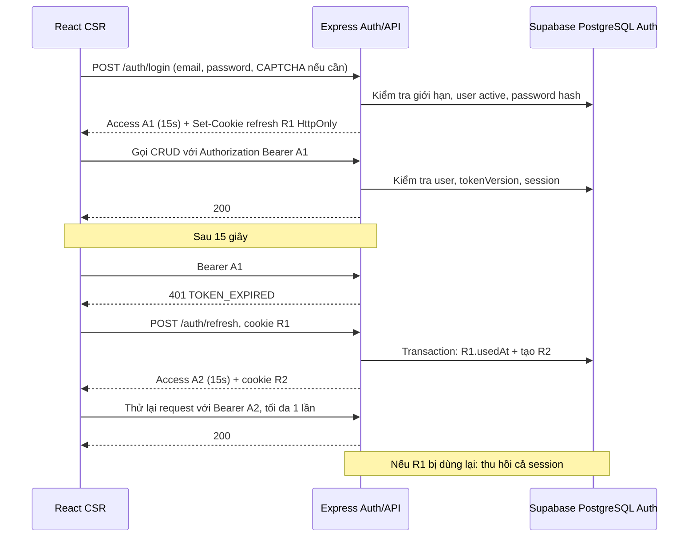

# Xác thực CSR — Bếp Nhà

Đặc tả: [Block 9, slide 26–35](https://pub.nndkhoa9.win/web/week7/block9-deck.html#26), quy tắc CAPTCHA/OTP theo [Block 8](https://pub.nndkhoa9.win/web/week6/block8-deck.html). Bổ sung của nhóm: access token **15 giây**, refresh-token rotation và trang trình diễn `/session`.

## Chạy trên lớp

Tại thư mục `BepNha_Nhom4`:

```powershell
npm install
npm run dev
```

Mở **http://localhost:5173**. Dùng cùng hostname `localhost` ở frontend và API; không trộn với `127.0.0.1` để tránh cookie bị coi là khác site. Chưa có Supabase key thì catalog dùng demo SQLite như trước; việc xác thực vẫn thực hiện ở API thật.

Frontend tự chuyển giữa `127.0.0.1` và `localhost` để khớp hostname local của `VITE_API_URL`, giữ nguyên đường dẫn/query/hash. Không mở rộng CORS sang origin tùy ý. Khi cấu hình lại môi trường local, `SPA_ORIGIN` vẫn phải khớp địa chỉ frontend sau chuyển hướng.

1. Vào `/register`, nhập email, mật khẩu và CAPTCHA ảnh.
2. Mặc định `MAIL_MODE=file`: email được ghi vào `api/data/mail-outbox`, không gửi ra Internet. Mở terminal thứ hai để đọc email gần nhất của mình:

   ```powershell
   npm run auth:mail -w api -- --email student@example.com
   ```

3. Nhập OTP tại `/activate`; kích hoạt xong phải đăng nhập riêng.
4. Đăng nhập rồi bấm email ở thanh đầu trang để mở `/session`.
5. Mở DevTools → Network, giữ trang này khoảng 15 giây cho bộ đếm về `00:00`, **không reload** vì reload sẽ refresh và cấp token mới.
6. Bấm **Kiểm tra phiên**: thấy `GET /api/auth/me → 401 TOKEN_EXPIRED`, `POST /api/auth/refresh → 200`, rồi `GET /api/auth/me → 200`.
7. Hoặc bấm **Gọi 3 yêu cầu đồng thời** sau khi token hết hạn: 3 yêu cầu dùng chung 1 lần refresh, từng yêu cầu được thử lại tối đa 1 lần.
8. Thử Đăng xuất, truy cập thẳng `/admin/dishes`, rồi thử luồng Quên mật khẩu. Đọc link reset bằng lệnh xem mail ở trên; link trỏ vào `/reset?token=...` trên frontend.

Hộp thư file là phương án local cho lớp học; muốn OTP/reset được gửi vào email thật, cấu hình SMTP bên dưới. Không có tài khoản/mật khẩu mặc định cho ứng dụng thật; tự đăng ký và kích hoạt.

## Cấu hình

Các biến đã được thêm vào `api/.env.example` và chỉ bổ sung biến còn thiếu trong `api/.env`, giữ nguyên cấu hình/credential đã có.

| Biến | Mặc định / ý nghĩa |
| --- | --- |
| `ACCESS_TOKEN_TTL_SECONDS` | `15`: thời hạn access token. API trả `expiresIn: 15`; `exp - iat = 15`. |
| `AUTH_DATABASE_PATH` | `./data/auth.sqlite`, tính từ working directory API. |
| `AUTH_DATABASE_DRIVER` | `auto` chọn PostgreSQL nếu có database URL, nếu không dùng SQLite. Máy nhóm đã đặt `postgres`. |
| `SUPABASE_DATABASE_URL` | Connection string Session pooler; dùng cho schema xác thực `bep_auth`. |
| `JWT_SECRET` | Local có thể để trống: sinh khóa ngẫu nhiên, lưu bền vững tại `auth.sqlite.key`. Production bắt buộc cấu hình ít nhất 32 byte ngẫu nhiên. |
| `AUTH_COOKIE_SECURE` | Local HTTP: `false`. Production luôn ép Secure. |
| `AUTH_COOKIE_SAME_SITE` | `lax`. Nếu deploy hai site khác nhau: `none` và HTTPS/Secure, đồng thời SPA origin phải đúng tuyệt đối. Chính sách chặn third-party cookie của trình duyệt vẫn có thể ảnh hưởng. |
| `MAIL_MODE` | `file` cho demo local; `smtp` để gửi mail thật. Production yêu cầu `smtp`. |
| `MAIL_OUTBOX_DIR` | `./data/mail-outbox`: hộp thư local, không nằm trong web public và không có endpoint đọc thư. |
| `MAIL_FROM` | Địa chỉ người gửi. Khi dùng SMTP cần đặt địa chỉ mà nhà cung cấp cho phép. |
| `SMTP_HOST`, `SMTP_PORT` | SMTP server, port mặc định `587`. |
| `SMTP_SECURE` | `false`: STARTTLS bắt buộc; `true`: TLS ngay từ đầu, thường port `465`. |
| `SMTP_USER`, `SMTP_PASS` | Credential SMTP, chỉ nằm ở backend. |

Ví dụ đổi sang mail thật trong `api/.env`:

```dotenv
MAIL_MODE=smtp
MAIL_FROM="Bep Nha <dia-chi-gui-cua-ban@example.com>"
SMTP_HOST=smtp.example.com
SMTP_PORT=587
SMTP_SECURE=false
SMTP_USER=...
SMTP_PASS=...
```

Khởi động lại API sau khi thay đổi. Không đặt các khóa này vào biến `VITE_*`.

## Chính sách đã công bố

| Thành phần | Quy tắc |
| --- | --- |
| Email | Trim, lưu bản nhập gốc; lowercase bản chuẩn hóa để so khớp/unique. Không áp quy tắc riêng của Gmail như bỏ dấu chấm hoặc dấu `+`. |
| Password | 10–128 ký tự, có chữ hoa ASCII, chữ thường ASCII, chữ số. Băm scrypt `N=32768, r=8, p=3`, salt ngẫu nhiên riêng 16 byte. Không tự băm bằng SHA-256. |
| User mới | `pending`, role `viewer`. Bỏ qua role/ID do client gửi. |
| CAPTCHA | `svg-captcha`, 6 ký tự; hạn 2 phút; một lần thử; gắn cookie phiên ẩn danh và mục đích `register`/`login`. Đổi ảnh hủy thử thách cũ. Server lưu HMAC đáp án, không trả đáp án trong JSON/cookie. |
| Đăng ký | CAPTCHA được kiểm tra trước khi hash password/tạo user/gửi mail. Tối đa 10 request/IP/15 phút. Email trùng có cùng response thành công, không gửi OTP mới. |
| Login | Cửa sổ 15 phút/email chuẩn hóa. Sau 3 lần sai cần CAPTCHA; đủ 10 lần sai khóa 5 phút. Đúng CAPTCHA không xóa bộ đếm. Thành công xóa bộ đếm email; không xóa giới hạn IP. Tối đa 60 request/IP/15 phút. |
| OTP | 6 chữ số ngẫu nhiên; hạn 10 phút; tối đa 5 lần sai. Tài khoản vẫn pending khi mã sai/hết hạn. Kích hoạt thành công và tiêu thụ mã trong một transaction, không trả token. |
| Gửi lại OTP | Chờ 60 giây; tối đa 5 lần/email/15 phút và 15 request/IP/15 phút. Mã mới khác mã cũ. Không xóa số lần thử khi gửi lại; chỉ sau khi đã khóa đủ 15 phút mới mở cửa sổ thử mới. |
| Kích hoạt | Tối đa 40 request/IP/15 phút. Sai/hết hạn/đã dùng: `INVALID_OTP`. Hết lượt thử: `429 RATE_LIMITED`. |
| Forgot | Cùng status/nội dung cho email tồn tại và không tồn tại. Tối đa 3 request/email/15 phút, 10/IP/15 phút. Chỉ tài khoản active nhận reset link. |
| Reset | Token ngẫu nhiên 32 byte, hạn 15 phút, lưu HMAC. Yêu cầu link mới vô hiệu link chưa dùng trước đó. GET frontend không tiêu thụ token; POST thành công mới đổi password và đánh dấu dùng. Tối đa 20 request/IP/15 phút. |
| Access | JWT HS256 bằng `jose`, có `iss`, `aud`, `sub`, `iat`, `exp`, `jti`, `sid`, `ver`. Verify thuật toán/chữ ký/hạn, đọc lại user và session từ database. Không tin role trong token/storage/body. |
| Refresh | Token ngẫu nhiên 32 byte, cookie HttpOnly, SameSite, path `/api/auth`, hạn tuyệt đối 7 ngày. Mỗi lần refresh: tiêu thụ R1 và tạo R2 trong cùng transaction. Không gia hạn vượt thời điểm kết thúc phiên ban đầu. |
| Refresh replay | Dùng lại R1 đã tiêu thụ: thu hồi toàn bộ family/session, A2/R2 cũng bị từ chối. Không lưu refresh token thô trong database. |
| Logout | Thu hồi session phía server và xóa cookie; JWT bị sao chép từ session đó cũng mất hiệu lực ngay. Các tab cùng origin nhận thông báo logout. Nếu mạng lỗi, UI báo rõ chưa hoàn tất logout ở server. |
| Reset password | Tăng `tokenVersion`, thu hồi **tất cả** session/refresh của user. JWT cũ bị từ chối ngay, không đợi 15 giây. Không tự đăng nhập; gửi mail thông báo đã đổi mật khẩu. |

Các giới hạn IP dùng `req.ip`; ứng dụng không tin `X-Forwarded-For` tùy ý. Khi deploy sau reverse proxy phải cấu hình trust proxy đúng hạ tầng trước khi dùng giới hạn theo IP. CAPTCHA ảnh chỉ phù hợp bài học, không bảo đảm chống OCR và chưa có phương án âm thanh cho người khiếm thị.

## Lưu token và rủi ro XSS/CSRF

- Access token chỉ ở biến module trong bộ nhớ, không ghi localStorage/sessionStorage. Reload mất bản sao này, ứng dụng gọi refresh để khôi phục phiên.
- Refresh token trong cookie HttpOnly nên JavaScript không đọc được. Secure được bật trong production/HTTPS; localhost HTTP dùng cấu hình local để demo.
- XSS vẫn có thể gọi API bằng phiên đang mở hoặc đọc access token trong quá trình chạy. In-memory/HttpOnly không làm XSS biến mất. React escape dữ liệu, không dùng `dangerouslySetInnerHTML`, và không hiển thị token ở `/session`.
- Các auth POST bắt buộc `application/json`; kiểm tra Origin chính xác, từ chối cross-site khi không có Origin hợp lệ; CORS chỉ cho phép SPA origin và credentials. Refresh/logout không nhận token qua URL hoặc body.
- Chỉ gắn Bearer cho base URL API cấu hình. `401 TOKEN_EXPIRED` thử refresh một lần; các `401` khác kết thúc phiên local và route guard chuyển về đăng nhập. Nếu refresh trả `401`, cũng về đăng nhập. Đây là phần mở rộng theo sơ đồ người dùng; slide gốc yêu cầu chuyển về login ngay khi 401.
- Lỗi mạng/5xx không xóa phiên. Refresh dùng single-flight trong tab, Web Locks để tuần tự hóa giữa các tab khi trình duyệt hỗ trợ.
- `403` báo thiếu quyền/nguồn không hợp lệ, không xóa access token. Bài này chưa phân quyền role, chưa MFA.

## API và quyền truy cập

Response giữ `{ ok: true, data }` hoặc `{ ok: false, error: { code, message, fields? } }`. Lỗi nghiệp vụ như sai login, validation, OTP/reset sai dùng HTTP 200. Lỗi authentication dùng 401; giới hạn dùng 429; từ chối Origin dùng 403; lỗi hệ thống dùng 500 với message chung.

| Request | Quyền / kết quả |
| --- | --- |
| `GET /api/auth/captcha?purpose=register` hoặc `login` | Ảnh và ID thử thách; cookie phiên ẩn danh HttpOnly. |
| `POST /api/auth/register` | `{email,password,captcha:{id,answer}}`; không trả access token. |
| `POST /api/auth/activate` | `{email,otp}`; chỉ kích hoạt. |
| `POST /api/auth/activate/resend` | `{email}`; phản hồi chung. |
| `POST /api/auth/login` | `{email,password,captcha?}`; trả `{accessToken,expiresIn,expiresAt,user}` và cookie refresh. |
| `POST /api/auth/refresh` | JSON `{}`, dùng cookie; trả access token mới + cookie R2. |
| `POST /api/auth/logout` | JSON `{}`, thu hồi phiên từ cookie. |
| `GET /api/auth/me` | Bearer hợp lệ; thông tin user lấy từ DB. |
| `POST /api/auth/forgot` | `{email}`; gửi link frontend nếu tài khoản phù hợp. |
| `POST /api/auth/reset` | `{token,password}`; không cấp access token. |
| `GET /api/dishes`, `/api/dishes/:id`, `/api/dishes/facets` | Công khai, giữ search/filter/sort/pagination cũ. |
| `POST/PATCH/DELETE /api/dishes...` | Tài khoản active có Bearer hợp lệ. |
| Mọi endpoint `/api/chefs...`, `/api/ingredients...` | Tài khoản active có Bearer hợp lệ, kể cả facets/GET. |

Mọi user active, kể cả `viewer`, đều được CRUD theo bài này. Route guard và ẩn nút không thay thế kiểm tra backend. `/admin/*`, `/chefs/*`, `/ingredients/*`, `/session` có guard; `/dishes` và chi tiết món vẫn công khai.

MSW offline CRUD cũ đã được tắt ở bootstrap, bỏ nút mở bản dùng thử trên lỗi mạng. Demo SQLite qua API vẫn hoạt động và vẫn yêu cầu đăng nhập cho CRUD. Điều này giúp demo không nhầm dữ liệu giả trên browser với hành vi xác thực server.

## Sơ đồ để nhóm giải thích



Frontend và auth/catalog routes cùng Express API; không thêm Order Service vì đối tượng của project là dishes/chefs/ingredients.

## Mô-đun và phần kế thừa Block 8

Repo không có source bài Block 8, nên đây là triển khai mới theo logic trong slide, không phải sao chép code SSR đã có.

| File | Vai trò / khác biệt CSR |
| --- | --- |
| `api/src/auth/crypto.js` | Password scrypt, token ngẫu nhiên và HMAC cho OTP/CAPTCHA/reset/refresh. |
| `api/src/auth/store.js` | Bảng user/challenge/reset/session/refresh/limit bền vững; transaction dùng một lần. |
| `api/src/auth/mail.js` | Email OTP/reset/thông báo; SMTP hoặc file local. |
| `api/src/auth/index.js` | Logic Block 8 đăng ký/OTP/brute force/reset; thay session SSR bằng JWT Bearer + refresh cookie. |
| `api/src/app.js` | Credentialed CORS, Authorization preflight và middleware bảo vệ CRUD. |
| `web/src/api.ts` | Một nơi gắn Bearer, xử lý refresh/retry/401; không redirect HTML từ API. |
| `web/src/Auth.tsx` | Form React, guard, logout, khôi phục phiên và trang demo `/session`. |

Auth hỗ trợ PostgreSQL Supabase và SQLite local. Bản cloud dùng schema `bep_auth`, RLS/grants chặn anon/authenticated, kết nối TLS đã xác minh. `auth:migrate` tạo bảng riêng và không sửa catalog; `auth:migrate -- --import-local` giữ user/password hash, không chuyển phiên cũ. Đổi nguồn catalog không đổi danh tính người dùng; lỗi auth cloud không tự fallback local. Bản chấm không credential có thể dùng SQLite/mail-file. Khi chạy nhiều instance, dùng PostgreSQL và cùng JWT_SECRET.

## Kiểm thử và bằng chứng nộp

```powershell
npm run build
npm test
npm run test:e2e
npm run auth:inspect -w api
```

`auth:inspect` chỉ đọc database xác thực, hiển thị hạn/usedAt/attempts và che email/hash. Không chạy migration/import Supabase để kiểm thử auth. Unit/API tests dùng in-memory database và đồng hồ có thể điều khiển để kiểm tra đúng mốc hết hạn; E2E dùng server test riêng ở 3101 và frontend production ở 5174. CAPTCHA cố định và user fixture **chỉ** có trong entry point `api/test/helpers/e2e-server.js`, không được import vào API thật.

Ảnh kiểm thử nằm trong `test-results/auth-activated.png`, `auth-session.png`, `auth-mobile.png`; các ảnh catalog cũ vẫn được tạo. Test frontend 3 request đồng thời giả lập ba response TOKEN_EXPIRED, sau đó gọi refresh và retry thật; test API riêng kiểm tra JWT thực sự hết hạn sau 15 giây. Không khẳng định bài kiểm tra frontend đã chờ thực tế 15 giây.

Khi thuyết trình/nộp: chụp giao diện, Network (OPTIONS/Authorization/401/refresh/retry), Application (cookie HttpOnly và không có access token trong Storage), email OTP/reset, bản ghi DB đã che. Test request trực tiếp nằm trong `api/test/auth.test.js`, gồm cả bỏ giao diện, token bị sửa, pending, CAPTCHA, OTP/reset lỗi, refresh replay và JWT cũ sau reset. Che toàn bộ Bearer, cookie và link/OTP thật trước khi chia sẻ.

### Lỗi do agent tạo và cách tái hiện

Ở bản tích hợp ban đầu, `AuthProvider` gọi `queryClient.clear()` trong effect khởi tạo, sau khi danh sách công khai đã bắt đầu tải. Query đang có observer bị xóa, khiến `/dishes?view=pages&pageSize=2` ở phiên chưa đăng nhập kẹt skeleton thay vì hiện 2 món.

Cách tái hiện bản lỗi: mở context browser mới, không cookie, đi thẳng URL trên; test Playwright `public catalog works without login; protected routes redirect and remember the requested URL` thất bại vì có 0 card sau timeout. Đã thay việc clear toàn bộ bằng chỉ xóa cache không hoạt động; dữ liệu private được gỡ khi guard unmount (gcTime=0). Đồng thời không hủy response thực đơn công khai chỉ vì startup xác nhận chưa có phiên. Test đó xác nhận hiện 2 món, điều hướng bảo vệ và reload sau đăng nhập hoạt động.

Gmail SMTP đã xác thực được ở cấu hình thật; lần rà soát không gửi thư mới hoặc đọc Inbox. Bằng chứng fixture không thay ảnh email đã nhận. Network/Application và ảnh email của phiên thực tế cần nhóm tự chụp, che token nếu giảng viên yêu cầu đúng dạng hình trực tiếp. Xem báo cáo Block 9 và `evidence/runtime-check.json`.
