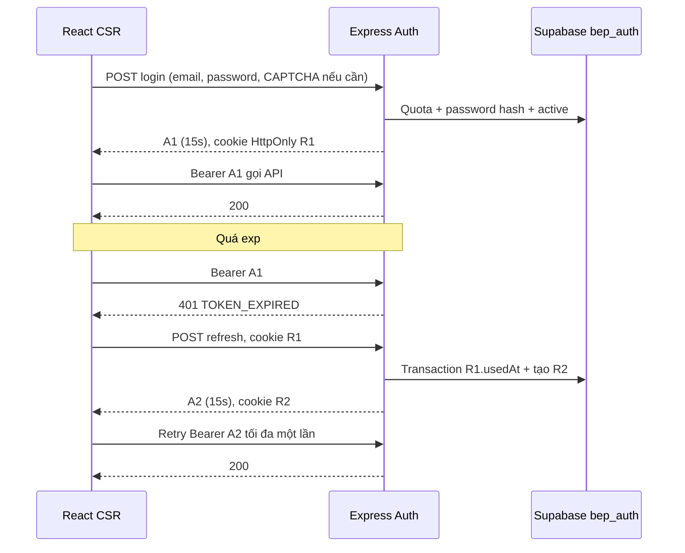

# Đối chiếu bài nộp Block 9 — Nhóm 4

Đề: [slide 26–35, Restaurant App CSR](https://pub.nndkhoa9.win/web/week7/block9-deck.html#26). Access token cuối cùng **15 giây** theo yêu cầu nhóm; refresh rotation là yêu cầu bổ sung theo sơ đồ người dùng.

## Chức năng và nghiệm thu

| Yêu cầu | Triển khai / kiểm chứng |
| --- | --- |
| Giữ API/web và search/pagination | React CSR + Express; tests catalog/UI qua. |
| Register | CAPTCHA trước password hash; default viewer, bỏ role body; response chung email mới/trùng. |
| OTP/resend | Hash HMAC, hạn 10 phút, tối đa 5 lần thử; resend có cooldown/quota, không tự đăng nhập. |
| Login | JWT HS256, exp 15 giây; sai trả 200/INVALID_CREDENTIALS; pending không có token. |
| Brute force | Sau 3 lần sai yêu cầu CAPTCHA; đủ 10 lần khóa 5 phút, cửa sổ 15 phút và giới hạn IP. |
| JWT verification | Chữ ký/issuer/audience/exp; đọc user, role và session từ DB; không tin role browser/body. |
| Public/protected API | GET dishes/detail public; ghi dishes và mọi chefs/ingredients cần active/Bearer; lỗi 401. |
| CORS | Exact origin + credentials + Authorization preflight. |
| Web | 5 form, adapter Bearer, guard admin, giữ URL quay lại; lỗi auth về login. |
| Bổ sung refresh | TOKEN_EXPIRED refresh/retry một lần; refresh thất bại hoặc 401 khác kết thúc phiên local. Đây là mở rộng so với 401 đơn giản trong slide. |
| Forgot/reset | Response chung, quota 429; link frontend /reset; chỉ POST tiêu thụ token; lỗi token chung. |
| Reset password | Không auto-login; tăng tokenVersion, thu hồi tất cả JWT/session/refresh cũ ngay. |
| Role/MFA | Mọi active user được CRUD, chưa phân quyền role, chưa MFA. |

Chi tiết test: `api/test/auth.test.js`, `auth-postgres.test.js`, `supabase.test.js`, `tests/auth.spec.ts`. Request trực tiếp: [api-acceptance.json](evidence/api-acceptance.json).

## Nơi lưu token và dữ liệu

- Access token trong module memory, không ghi vào Storage; reload dùng refresh khôi phục phiên.
- Refresh token cookie HttpOnly/SameSite, Secure khi production/HTTPS. DB chỉ lưu hash và usedAt.
- XSS vẫn có thể hành động bằng phiên đang mở; memory/HttpOnly không thay phòng chống XSS. React escape dữ liệu và không đưa secret vào VITE_*.
- Supabase PostgreSQL: schema `bep_auth`, user/challenge/reset/session/refresh/counter. RLS và schema grants chặn anon/authenticated; kết nối backend có TLS verify.
- Không credential: bản chấm dùng SQLite/mail-file. Bản cloud của nhóm đã bật PostgreSQL/Gmail; danh tính không tự fallback sang local khi lỗi.

## Luồng JWT

Mở [flow-login.svg](flow-login.svg) để trình bày. Sơ đồ do mã nguồn bài nộp dựng; nhóm cần hiểu và giải thích được:

## Logic Block 8 và thay đổi CSR

Repo đầu vào không có source Block 8. Đây là triển khai theo logic đặc tả, không khẳng định chuyển nguyên mã SSR có sẵn.

| Mô-đun | Logic theo Block 8 | Thay đổi CSR |
| --- | --- | --- |
| api/src/auth/crypto.js | Scrypt, hash OTP/reset | Random refresh/HMAC. |
| api/src/auth/index.js | Register/CAPTCHA/OTP/brute force/forgot/reset | JSON REST, JWT/refresh/logout/me; không redirect HTML. |
| store.js/backend.js/postgres.js | Store bền vững, transaction | SQLite/PostgreSQL, session family, tokenVersion, serializable retry. |
| api/src/auth/mail.js | Gửi OTP/reset | Link React /reset; Gmail SMTP hoặc file local. |
| web/src/api.ts | Không có phần tương ứng SSR | Bearer, memory, single-flight/retry, 401/403/network riêng. |
| web/src/Auth.tsx | Form theo luồng xác thực | React form/guard/restore/logout, trang /session. |

## Lỗi agent đã sửa

1. `queryClient.clear()` ở effect khởi tạo làm danh sách public kẹt skeleton. Tái hiện bản lỗi: browser mới → `/dishes?view=pages&pageSize=2`, không hiện 2 card. Sửa: chỉ xóa inactive cache và không hủy public response vì startup chưa có phiên. Test `public catalog works without login...` qua; ảnh/network ở evidence/browser.
2. Read fallback wrapper thiếu `parseId`, list vẫn 200 nhưng detail `/dishes/13493` trả 500 trước khi query. Sửa: delegate `active.parseId(value)`, kiểm tra GET/PATCH/DELETE và sau khi chuyển demo. Test `Supabase read fallback preserves ID parsing...` đã tái hiện 500 trước sửa và qua sau sửa. Cloud detail thật được ghi trong runtime-check.json.

## Bằng chứng

- [Báo cáo HTML](BAO_CAO_BLOCK9.html): ảnh UI fixture, Network/Storage đã che, request trực tiếp, DB và sơ đồ.
- `evidence/api-acceptance.json`: 43 kiểm tra, snapshot hash/hạn/usedAt/attempts và email fixture đã che.
- `evidence/browser/`: ảnh/JSON từng kịch bản; token/password/cookie được che, email example.com là fixture.
- `evidence/runtime-check.json`: Supabase/TLS, Gmail SMTP authentication, tài khoản dùng tên giả; không có email thật/secret.
- **Nhóm bổ sung** ảnh email OTP/reset thật đã che và ảnh F12/Storage trực tiếp nếu giảng viên yêu cầu đúng dạng hình DevTools cho từng kịch bản. Không gọi fixture là mail Gmail thật, không gọi JSON tự động là ảnh F12.

## Demo F12

Network → Keep log → Fetch/XHR. Đăng ký xem register/Payload/Preview; OTP xem activate; login/Preview có expiresIn=15 và Headers/Set-Cookie. Sang /session, xóa log, chờ 00:00, kiểm tra: me 401 → refresh 200 → me 200. Application/Cookies có HttpOnly, Storage không có access token. Che credential/token khi nộp.
